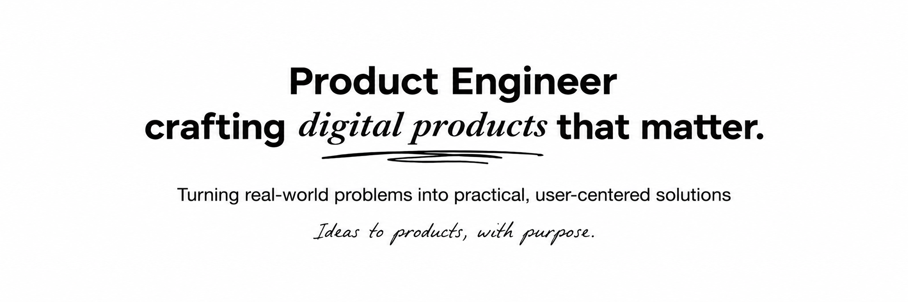
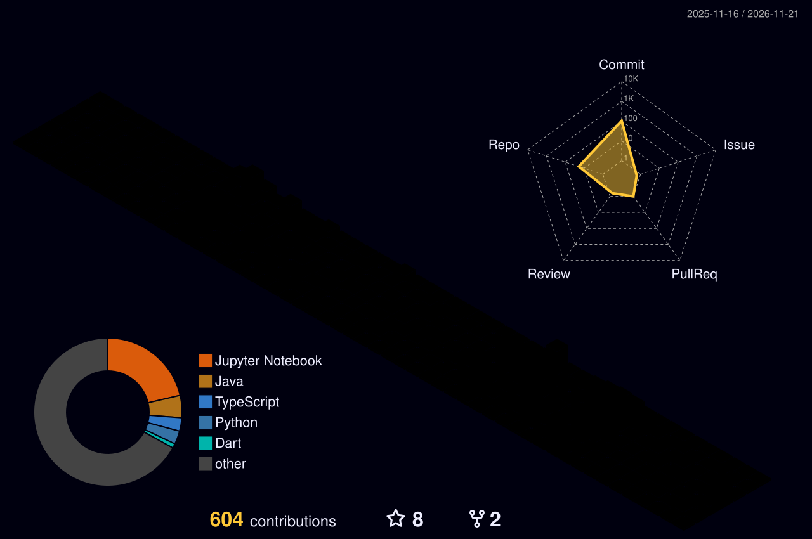

# Hey there! I'm Isuru

### ### 💻 Product Engineer | Digital Product Development | BSc (Hons) IT Graduate

BSc (Hons) in Information Technology graduate with practical experience in digital product development, system analysis, UI/UX design, and frontend implementation. Experienced in translating business requirements into functional workflows, designing intuitive interfaces, and contributing to software solutions that address real-world needs. Focused on combining technical understanding, product thinking, and user-centered design to create practical and meaningful digital experiences.

As AI continues to transform software development, I believe effective engineering goes beyond writing code. It requires understanding problems, making thoughtful decisions, and designing solutions with purpose. I embrace AI-assisted development as a way to enhance creativity, efficiency, and problem-solving while keeping human judgment, usability, and product value at the center.

---

## 📮 Contact's & Social's

  

<em>Let’s build something meaningful together.</em>

## 💻 Technology Stack

### Languages

### Frameworks & Libraries

### UI Libraries & Styling

### Build Tools & Package Managers

### Version Control & CI/CD

### Cloud & DevOps

### AI & Neural Networks

### Development Tools & IDEs

---

## 👻  &nbsp;Pacman Contribution Graph:

 <picture>
  <source media="(prefers-color-scheme: dark)" srcset="https://raw.githubusercontent.com/lsuruDilshan/lsuruDilshan/output/pacman-contribution-graph-dark.svg">
  <source media="(prefers-color-scheme: light)" srcset="https://raw.githubusercontent.com/lsuruDilshan/lsuruDilshan/output/pacman-contribution-graph.svg">
  
</picture>

## 📈 Github Stats & Activity Graph

<!-- 

  

 -->

## ⏳ Time Invested in Coding

<!--START_SECTION:waka-->
<!-- WakaTime coding statistics will appear here if you configure the optional integration. -->
<!--END_SECTION:waka-->

<em>Thank you for visiting my profile!</em>

